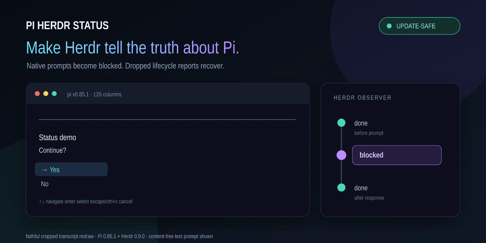

<div align="center">

# Pi Herdr Status

**Make Herdr tell the truth about what Pi is doing.**

A standalone downstream fork of [Herdr's](https://github.com/herdrdev/herdr) Pi lifecycle integration.

[](CHANGELOG.md)
[](LICENSE)
[](https://pi.dev/packages)
[](docs/privacy-security.md)

</div>

Pi Herdr Status keeps a Pi pane **working while async subagents run**, marks native Pi prompts **blocked**, and repairs dropped lifecycle reports through one status authority.

> [!IMPORTANT]
> This package **replaces** Herdr's bundled Pi extension. Do not load both at once: both would publish the same `herdr:pi` source with independent sequences. Repository creation, package publication, and active installation remain separately gated.

<picture>
  <source media="(max-width: 700px)" srcset="media/gallery-mobile.webp" width="800" height="640">
  
</picture>

_Faithful cropped redraws from real Pi 0.85.1 and Herdr 0.9.0 sessions. They contain only content-free test data; private prompts, paths, model identity, footer, and unrelated startup output are absent._

## Why this fork exists

Herdr's bundled Pi integration owns semantic lifecycle reporting but does not consume the forward-compatible `herdr:busy` event emitted by `pi-subagents`. The parent therefore settles to `idle` even while an async child is still running. Native Pi prompt events are also absent, and a lost terminal report can leave stale state.

This extracted fork keeps the original source/sequence owner and adds the missing inputs inside that same authority:

```text
blocked prompts / attention
            │
            ▼
         BLOCKED
            │ otherwise
            ▼
parent active OR async busy lease
            │
            ▼
         WORKING
            │ otherwise
            ▼
           IDLE
```

A 30-second heartbeat republishes the current authoritative state. It does not poll pane contents and does not create a second reporter.

## Install

The safe handoff stages this replacement first, then removes Herdr's bundled hook, and reloads only after exactly one authority remains.

### 1. Stage and verify this replacement

After stable publication:

```bash
pi install npm:@eysenfalk/pi-herdr-status
```

For a pinned published release candidate:

```bash
pi install npm:@eysenfalk/pi-herdr-status@1.0.0-rc.0
# or: pi install git:github.com/eysenfalk/pi-herdr-status@v1.0.0-rc.0
```

Before publication, clone or unpack the reviewed source, run `npm ci && npm run check`, then register its absolute directory without reloading Pi:

```bash
pi install /absolute/path/to/pi-herdr-status
pi list
```

If staging fails, stop here; the bundled integration remains intact. Do **not** run `/reload` yet, because that would load both authorities.

### 2. Remove the bundled integration

```bash
herdr integration uninstall pi
```

Confirm that `~/.pi/agent/extensions/herdr-agent-state.ts` is gone or disabled. If removal fails, remove the staged package with `pi remove <the exact source shown by pi list>` and keep using the bundled hook.

### 3. Activate one authority

Run `/reload` in existing Pi sessions or start a fresh Pi pane in Herdr. Verify `pi list` contains this package and that the bundled file is absent.

### Roll back to Herdr's bundled integration

First remove this package using its exact source from `pi list` and verify it is absent. Only then reinstall Herdr's hook:

```bash
pi list
pi remove npm:@eysenfalk/pi-herdr-status
pi list
herdr integration install pi
```

For Git or local sources, substitute the exact source shown by `pi list`. Then reload or restart Pi. See [Troubleshooting](docs/troubleshooting.md) for failure recovery and duplicate-authority checks.

## Behavior

| Pi state | Herdr semantic status |
| --- | --- |
| Parent agent is generating or running tools | `working` |
| One or more async `pi-subagents` runs remain active | `working` |
| Native Pi prompt or subagent attention awaits you | `blocked` |
| Parent settled and no async work or blockers remain | `done` / `idle` |
| A lifecycle delivery was lost | Reasserted by bounded retry or heartbeat |

Busy and blocker leases are counted independently. Blocking always wins; releasing the final blocker returns to `working` when either the parent or an async run remains active.

No commands, tools, keybindings, model messages, or settings are added.

## Safety and privacy

- One semantic reporter: source `herdr:pi`, with monotonic sequence values.
- Local Herdr socket only; no internet requests, analytics, subprocesses, persistence, or model calls.
- No runtime dependencies or install hooks.
- Prompt **kind** selects a fixed label; prompt titles, values, and contents are never inspected.
- Busy/block labels are normalized, stripped of control characters, and bounded before local reporting.
- Socket acknowledgements are matched, errors are rejected, responses are bounded to 64 KiB, and in-flight writes are abortable.
- Delivery retries back off to 30 seconds; a matching heartbeat is intentionally idempotent.

Read [Architecture](docs/architecture.md), [Privacy and security](docs/privacy-security.md), and [Upstream relationship](docs/upstream.md) for the exact contract.

## Requirements

- Node.js 22 or newer
- Pi with `agent_settled`, `ui_prompt_start`, and `ui_prompt_end`
- Herdr supplying `HERDR_ENV`, `HERDR_SOCKET_PATH`, and `HERDR_PANE_ID`
- `pi-subagents` for async busy/attention integration
- Herdr's bundled Pi integration uninstalled or disabled

The candidate baseline targets **Pi 0.85.1**, **Herdr 0.9.0**, and **pi-subagents 0.66.0** on Linux. See [Compatibility](docs/compatibility.md) for validated and unverified platforms.

## Development

```bash
git clone https://github.com/eysenfalk/pi-herdr-status.git
cd pi-herdr-status
npm ci --ignore-scripts
npm run check
npm run smoke:packed
```

For real Herdr/Pi checks and faithful terminal evidence, follow [Development and TUI validation](docs/development-workflow.md).

## Scope and provenance

This is not a Herdr orchestrator or a subagent runner. It is a narrow replacement for one bundled lifecycle extension. The extraction baseline and refresh procedure are recorded in [Upstream relationship](docs/upstream.md) and [`NOTICE`](NOTICE).

Herdr and Pi are independent projects. This community fork is not affiliated with or endorsed by either project.

## License

[Apache License 2.0](LICENSE)
